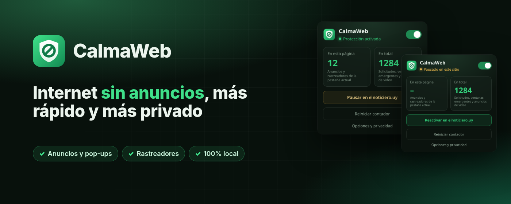
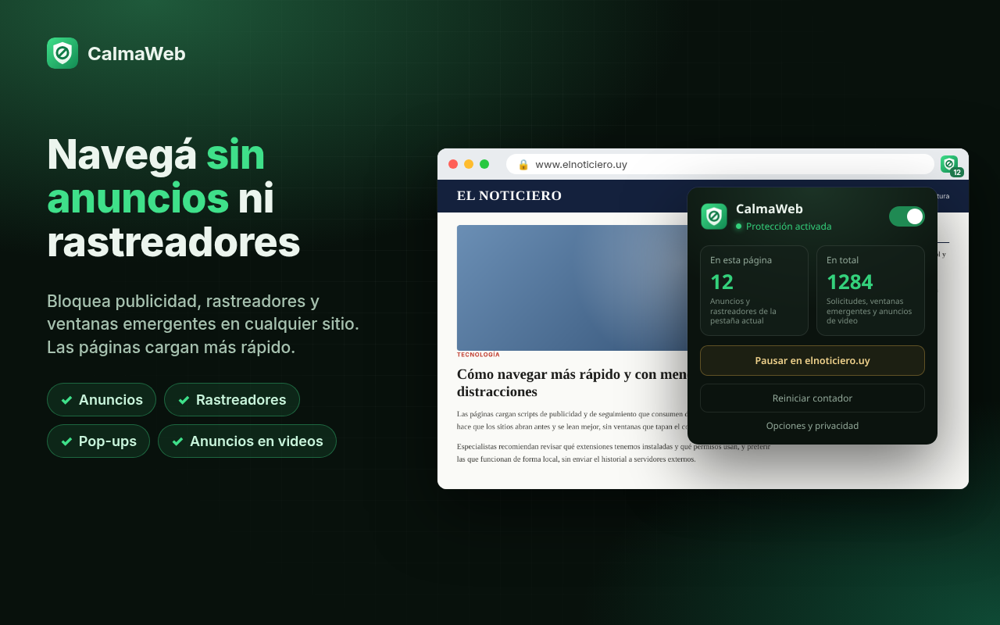
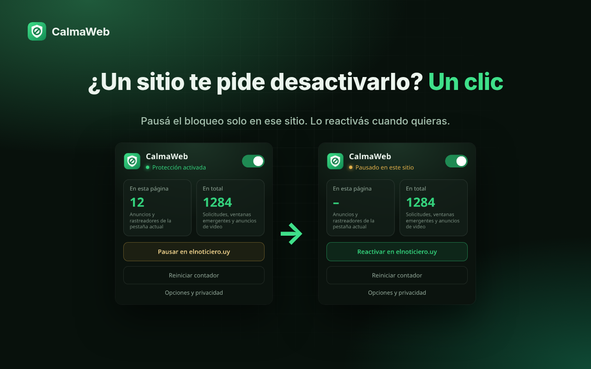
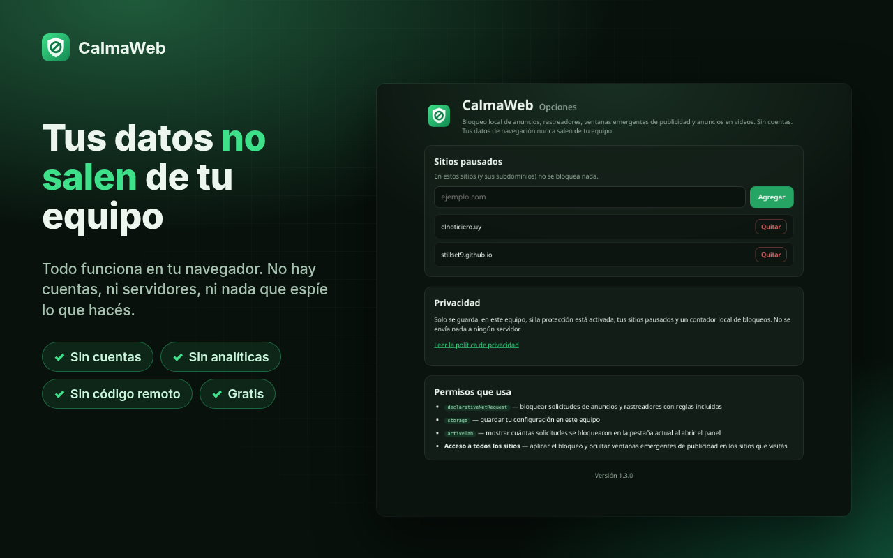
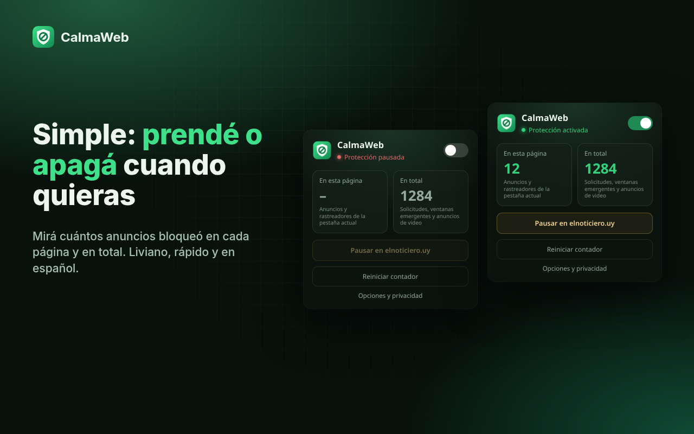
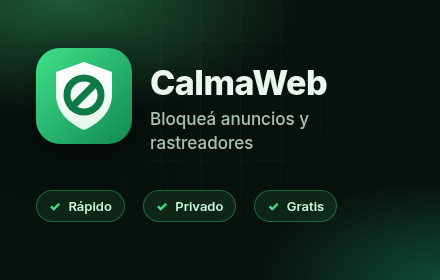
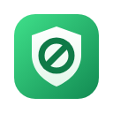

# CalmaWeb: el proceso de desarrollo

Videos e imágenes que muestran cómo hice **CalmaWeb — bloqueador de anuncios**, mi extensión para Google Chrome, desde la idea hasta enviarla a la Chrome Web Store.

## Videos

| Video | Formato | Duración | Descargar |
| --- | --- | --- | --- |
| Para TikTok / Reels | Vertical 1080×1920 | 41 s | [calmaweb-proceso-tiktok-1080x1920.mp4](https://github.com/Stillset9/calmaweb-proceso/raw/main/videos/calmaweb-proceso-tiktok-1080x1920.mp4) |
| Para LinkedIn | Horizontal 1920×1080 | 60 s | [calmaweb-proceso-linkedin-1920x1080.mp4](https://github.com/Stillset9/calmaweb-proceso/raw/main/videos/calmaweb-proceso-linkedin-1920x1080.mp4) |

La música es sintetizada para estos videos (libre de derechos). Los textos para publicar están en [LINKEDIN.md](LINKEDIN.md).

## Qué es CalmaWeb

Una extensión para Chrome (Manifest V3) que bloquea anuncios, rastreadores y ventanas emergentes de publicidad. Todo funciona dentro del navegador: no hay cuentas, ni servidores, ni analíticas.

- Bloquea solicitudes a redes de publicidad y rastreo conocidas con `declarativeNetRequest`: 48 reglas estáticas (31 generales y 17 para YouTube).
- Frena las ventanas emergentes (`window.open()`) que van a redes de anuncios.
- Oculta espacios de anuncios en YouTube.
- Muestra cuántos elementos bloqueó en la página actual y en total.
- Pausa el bloqueo en un sitio con un clic, e incluye un interruptor general.
- Interfaz en español y en inglés.
- Permisos mínimos: `declarativeNetRequest`, `storage` y `activeTab`.

## El proceso

1. **La idea:** navegar sin anuncios y sin rastreadores, sin mandar ningún dato afuera del equipo.
2. **El código:** Manifest V3, con un service worker, scripts de contenido, un panel y una página de opciones.
3. **Las reglas:** listas JSON que Chrome aplica directamente, sin que la extensión lea las páginas.
4. **Pausa por sitio:** reglas dinámicas `allowAllRequests` solo para el dominio que pausás.
5. **La interfaz:** panel con contador y página de opciones.
6. **Imágenes de la tienda:** 4 capturas de 1280×800, mosaico, marquesina e ícono.
7. **Nuevo nombre:** la versión 1.2.0 se llamaba "AdBlock Lite". En la 1.3.0 pasó a ser **CalmaWeb**, porque "AdBlock" es una marca registrada.
8. **Chrome Web Store:** la versión 1.3.0 se envió el 10 de octubre de 2026 y está **pendiente de revisión**.

## Imágenes

| | |
| --- | --- |
|  |  |
|  |  |

 

Vista general de todos los recursos: [preview.png](imagenes/preview.png)

---

Héctor Juani · [@stillset9](https://www.tiktok.com/@stillset9) · [github.com/Stillset9](https://github.com/Stillset9)
